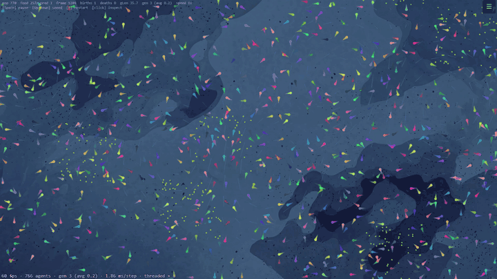

# evo_boids

An artificial-life simulation in C++20 where fish with small neural networks evolve by inheritance and mutation. It runs natively and in the browser through WebAssembly.

**Live demo:** _link goes here after the first deploy_

 <!-- placeholder: GIF to be recorded -->

## What it simulates

Every creature has a **genome**: a list of 16–80 genes, where each gene is one weighted connection in a small neural network. A connection runs from one of 41 sensors (nearby creatures, food, pheromone, own energy, age, an internal oscillator, …) or one of 12 hidden neurons to a hidden neuron or one of 12 actions (steer, speed up, emit a signal, reproduce, share food, fight, …). The genome fixes the network at birth, and the network never learns during the creature's life.

**Nothing scores the creatures. There is no fitness function and no training loop.** Each creature burns energy every second, and it dies when its energy runs out, when it reaches its maximum age, or when a predator catches it (predators are optional). When two creatures meet, their networks' outputs are summed. The pair then shares food, reproduces, fights, or ignores each other, depending on which option scores highest. Reproduction also needs enough energy in both. The child gets a crossover of the two genomes plus random mutation. So selection is only this: genomes whose behaviour finds food and partners leave copies, and the rest don't.

The question the project asks is which environmental pressures (food scarcity, a cost on movement, ocean currents, predators) are enough to produce a collective behaviour such as schooling.

Optional mechanisms, all off by default: predators that eat, breed and starve; food in patches; ocean currents; heritable body size and elongation; a genetic-distance limit on who can pair with whom.

## Architecture

```
src/core/      the simulation: header-only, no rendering, no OS calls (evo_core)
src/render/    SFML window frontend (native only)
src/app/       native entry point: headless runs, CLI flags, CSV logging
wasm/          C API for JavaScript, Emscripten build, benchmarks, parity test
web/           browser frontend: canvas renderer, module loader, Turbo worker
tests/         core_tests, predator_smoke, core_bench (no SFML needed)
```

- **Spatial index.** Creatures and food go into uniform grids (`spatial_grid.hpp`), with cell size equal to the perception radius. The grids are rebuilt every step without reallocating, and a neighbour query only scans the cells overlapping its radius.
- **One step.**
  - The per-creature phase (sense, run the network, move) only writes to the creature being updated, so it runs in parallel.
  - Eating, interactions, births and deaths change shared state, so they run on one thread.
- **Parallelism.**
  - Native: OpenMP.
  - Browser: the same loop runs on a small thread pool (`thread_pool.hpp`) over Emscripten pthreads.
  - Both threaded paths give each thread its own random generator, so a threaded run cannot be replayed from its seed.
- **Determinism.**
  - The single-threaded build reproduces a run exactly from its seed.
  - Floating point is compiled with `-ffp-contract=off` and never `-ffast-math`, and the core uses its own copies of the math functions it needs.
  - With that, the native single-threaded build and the single-threaded WebAssembly module write byte-identical checkpoints for the same seed and step count. `wasm/parity.sh` checks this across 19 seed/config cases.
- **Browser module.**
  - JavaScript calls a small C API (`wasm/evo_wasm.cpp`): `evo_init`, `evo_step(n)`, `evo_reset`, `evo_set_param`, `evo_sync`, plus getters.
  - The getters return pointers into the wasm heap, and the renderer reads them as typed-array views every frame. No copies, no JSON.
  - Checkpoints are JSON and load in both the native build and the browser.
- **Two browser builds.**
  - `evo_boids_mt` uses pthreads. It needs `SharedArrayBuffer`, which browsers allow only on cross-origin-isolated pages (COOP `same-origin` + COEP `require-corp`).
  - `evo_boids` is single-threaded.
  - `web/loader.js` checks `self.crossOriginIsolated` and picks one. Inside an iframe on a page without those headers, it always gets the single-threaded build.
- **Drawing.** With WebGL2, the background, food, fish and predators are drawn with one instanced draw call per kind (`web/gl_renderer.js`). The result is copied onto a 2D canvas, which draws the HUD and the neural inspector on top, the way the native SFML window does. Without WebGL2, everything is drawn with canvas 2D, at one fill per body segment. The controls around the world (a live readout, a playback dock, the settings, Turbo) are HTML, outside the canvas. An opt-in **tank view** draws the same world in 3D instead (below).
- **Frame budget.** When a frame takes too long, the page first lowers the simulation speed (in the tank view, it first draws the tank with less detail). Then it removes creatures uniformly at random and caps births, so the agent count drops instead of the frame rate. A message says when this happens, and the readout keeps an orange dot for the rest of the run, because a run changed this way can no longer be replayed from its seed. It can be switched off ("hold 60 fps").

## Build and run

### Native

Requires CMake ≥ 3.16, a C++20 compiler, and optionally OpenMP and SFML 2.6. Without SFML the window app is skipped, and the tests and benchmark still build.

```bash
cmake -S . -B build && cmake --build build -j              # OpenMP: fast
cmake -S . -B build_serial -DEVO_NO_OPENMP=ON && cmake --build build_serial -j   # deterministic
(cd build_serial && ctest)                                 # core_tests + predator_smoke
./build/evo_boids --headless 50000 --name run1 --log-every 2000 --no-render
./build/evo_boids                                          # windowed (SFML)
```

`docs/evo_boids_flags.md` lists every CLI flag.

### Browser (WebAssembly)

Requires [Emscripten](https://emscripten.org) (`source ~/emsdk/emsdk_env.sh`) and CMake ≥ 3.21 for the presets.

```bash
cmake --preset wasm-st && cmake --build --preset wasm-st   # -> web/evo_boids.{js,wasm}
cmake --preset wasm-mt && cmake --build --preset wasm-mt   # -> web/evo_boids_mt.{js,wasm}

python3 wasm/serve.py            # serves the repo root WITH COOP/COEP
                                 # open http://localhost:8123/web/  (threaded)
python3 -m http.server 8123      # plain server: same page, single-threaded
```

Page options:

| Option | Effect |
|---|---|
| `?threads=0` | forces the single-threaded module |
| `?nthreads=N` | sets the thread count |
| `?bench` | runs the frame-rate benchmark below |
| `?gl=0` | forces canvas 2D drawing instead of WebGL2 |
| `?guide=0` / `?guide=1` | never / always start the first-visit guide on load |
| `?view=3d` / `?view=flat` | starts in the tank view / the flat view (otherwise the page remembers the visitor's last choice; flat the first time) |
| `?fish=1` / `?fish=0` | draws the flat view's fish as fish shapes / as circles (otherwise remembered; circles the first time) |

Keyboard: <kbd>Space</kbd> pause · <kbd>↑</kbd> <kbd>↓</kbd> speed · <kbd>R</kbd> a fresh world · <kbd>Esc</kbd> closes what is open (the settings, the live numbers, then the selected fish). Click a fish to inspect it, empty water to let it go. In the tank view also <kbd>F</kbd> follow the selected fish · <kbd>C</kbd> fit the view; drag to pan, scroll to zoom (towards the pointer), right-drag to tilt and turn.

Browser requirements:
- **WebAssembly.**
- **WebGL2**, optional: without it the fish are drawn with canvas 2D, which is slower at high counts.
- **Cross-origin isolation** for the threaded module: Chrome 92+, Firefox 79+ and Safari 15.2+ support it. Anywhere else, the page runs the single-threaded module.

Tested on Windows 11 in:
- Chrome 155
- Playwright's Firefox 155 build
- Playwright's WebKit 26.6 build, which is Safari's engine but not Safari itself

Checks run in each:
- the threaded module and WebGL2 drawing on the isolated page
- `?threads=0` and `?gl=0`
- the single-threaded fallback without isolation headers
- running inside a cross-origin iframe
- Turbo on and off
- checkpoint download

Safari on macOS/iOS has not been tested.

### Phones and touch screens

Every screen gets the same controls around the world: the live readout at the top left (fish, generation, frame rate; tap it for the rest), the dashboards and settings buttons at the top right, and a playback dock at the bottom (pause, speed, Turbo, Randomize). On a desktop with a mouse they sit around the world, not over it, and the world itself is drawn exactly as before: the canvas is pixel-identical to the previous page's for a fixed checkpoint, HUD and inspector included. Small and touch screens, and windows 560 px tall or less (such as an embed), differ:

- **World shape.** In portrait, or on any touch screen, a start or restart creates a world with the area of 1920×1080 but the shape of the screen, so it fills the screen instead of a 16:9 strip. Food density and crowding stay the same. Rotating the device keeps the running world, and a "fit to screen" button restarts it with a fitted one. A checkpoint keeps its own size, and `?bench` always uses 1920×1080. The controls float over the world here.
- **The selected fish.** On screens 700 px wide or less, windows 560 px tall or less, and touch screens, the inspector is a card instead of a canvas panel: energy (with the breeding threshold marked), age and speed, and the live network below, where tapping a node names it. The card sits at the bottom of a phone (on the right of a wider screen) and moves to the other side when the fish swims under it. The on-canvas HUD is left out there; the readout carries the essentials.
- **Settings** open as a bottom sheet you can drag down to close; on screens 960 px wide or more they sit beside the world instead.
- **Touch.** A tap selects the nearest fish within about 24 CSS px. Tapping a setting's name shows its explanation. Inputs use 16 px text, so iOS does not zoom the page on focus, and buttons and rows are at least 44 px tall.
- **Load.** Touch devices start with 200 creatures (single-threaded) or 400 (threaded), on at most 4 threads; `?nthreads=N` overrides the thread count. The threaded module still pre-spawns min(cores, 8) − 1 workers. The frame-budget governor works as everywhere else.

So far this is measured in emulation only: Playwright's iPhone 13 profile in WebKit 26.6 and its Pixel 7 profile in Chrome 155, portrait and landscape. The world covers 99.7–99.8% of the screen in all four cases, of which the top bar and the dock float over about 11% (Pixel 7, portrait); the fish card with its network open covers 43% (Pixel 7) and 49% (iPhone 13). No real phone has been tested, so frame rate, battery use, memory, and whether the threaded module starts on iOS are unmeasured.

### Tank view (opt-in)

A switch in the settings' Run tab (or `?view=3d`) draws the same world as a shallow 3D tank seen at an angle, made with three.js (`web/scene3d.js`, by techy-Nik). It changes nothing in the simulation, only the picture, and it is off unless a visitor turns it on. The flat view stays the default because it shows the world as the simulation sees it; the tank is for looks, and takes liberties:

- **What is drawn from the simulation:** every fish's six spine points (bent through with a spline), genome colour and body size; food positions; predator positions and whether they are hunting or digesting; the current's flow grid.
- **What is added for looks:** a tail beat, a fixed swim height per fish (±4 world units), lighting, shading and fog (a fish's back is drawn darker than its genome colour, distant fish fade toward the water), shadows, caustic light, drifting specks of "marine snow" that are not food, and each predator's recent path used as its spine.
- **What the perspective changes:** distant fish look smaller and distances aren't uniform across the screen. The tank has walls, but the world still wraps, so fish swim through one wall and come back at the opposite one.

The selected fish is shown as the card on every screen in the tank view (there is no canvas inspector), and the camera pans, zooms, tilts and follows a fish. three.js ships as a trimmed bundle, `web/vendor/three.bundle.min.js` (561 KB minified; about 115 KB brotli by #7's measurement), loaded only when the tank view is first turned on, so the default page is no heavier. `tools/three_bundle/build.sh` rebuilds it, and the rebuilt file is byte-identical to the committed one (three 0.186.1, esbuild 0.28.2). Without WebGL2 the switch says so and stays off.

Cost, as measured in #7 on the benchmark machine below (Chrome with the Iris Xe GPU, threaded × 8, 1440×900): the tank holds a stable 60 fps up to 10,000 agents (52.2 fps at 12,000), against 12,000 for the flat view, and spends about 1.2 ms per frame drawing 2,000 agents against 0.8 ms. Re-measured on the same laptop in a windowed Chrome 155 (AC power, 2 rounds alternating the views): the flat view held the display's rate up to 12,000 agents and the tank up to 10,000, as in #7, and drawing took 0.70 against 1.06–1.11 ms at 2,000 and 0.87–0.88 against 2.18–2.19 ms at 8,000. Headless (2026-10-20, 2 rounds): drawing took 0.79–0.80 ms flat against 1.10–1.11 ms in the tank at 2,000 agents, 1.41–1.44 against 2.75–2.92 ms at 8,000, and 1.51–1.54 against 2.42–2.74 ms at 12,000. Both held a stable 60 fps up to 6,000 there, because on that run the simulation step (12.5–13 ms at 8,000) set the limit, not the drawing. In a windowed Firefox 155 (Playwright's build), drawing took 1.26–2.34 ms flat against 0.8–2.12 ms in the tank, at every count up to 12,000 (see Benchmarks). That cost is only paid with the tank on; the governor's first step there is to draw it with less detail.

### Fish shapes (opt-in)

A second switch in the Run tab (or `?fish=1`) draws each fish in the flat view as one body instead of six circles. The shape is a skin over the same skeleton, so it shows body size and elongation the way the circles do:

- **Length** is the spine the core keeps, six points `4 × bodySize × bodyElong` apart at most (`Creature::updateBody`), bent through with a Catmull-Rom curve.
- **Width:** the half-width at each spine point is that point's circle radius, `RADII[i] × bodyScale(bodySize)` with the same floor, and runs linearly between them. The head is the head circle.
- **The tail fin** is the one addition: 6 world px long and 9 across (tip to tip) at body scale 1, scaled by the same `bodyScale`, at 55% opacity.
- **At the world's edge** a fish is drawn as its six circles for a moment. The core wraps a creature's position and then pulls its trail by plain, unwrapped distance (`World::step`, `Creature::updateBody`), so right after crossing an edge the trail lies ahead of the head, on the new side, until the head swims through it. Circles show that as overlapping dots; a fish shape would swim backwards. So, until the fish has travelled 260 px past the crossing, while any segment of its trail points along its motion, it is drawn as circles, exactly as with the switch off. A test that replays the core's trail rule over 8 crossings (edges, a corner, slow and fast, short and long fish, up to 50 steps a frame) finds every backwards frame drawn as circles and no other, and a fish circling far from the edges never drawn as circles.
- **Colour:** body and head are drawn opaque in the genome colour; the circles fade toward the tail instead.
- **Drawing:** WebGL2 only. Every fish is one instanced draw of a 55-vertex template, bent in the vertex shader, in the same creature order. The canvas-2D fallback (no WebGL2, or `?gl=0`) keeps the circles, and the switch says so: in Chrome, canvas 2D filled the outlines at less than half the frame rate of circles (250 bent fish in a test page: 20 against 45 fps in a windowed Chrome 155, 22 against 60 headless; Firefox filled both at about 60), because each filled polygon costs far more there than an arc. Splitting the outline into convex pieces made it slower, not faster. The native app still draws circles.

**Measured faithfulness.** A test world holds 15 isolated, straight fish: body size 0.5, 0.75, 1, 1.5 and 2, each at elongation 0.5, 1 and 2. Differencing it against the same world without them gives each fish's pixels. With fish shapes, each fish is exactly as wide as its circles, and its length is within 1 px of the geometry (five spine segments, plus the head radius, plus the fin), in all 15 cases. That holds in Chrome 155, Playwright's WebKit build (installed 2026-10-20, Playwright 1.63) and Playwright's Firefox 155. As with circles, body sizes 1.5 and 2 draw the same width, because `bodyScale` levels off at 1.4×; their lengths still differ.

**Across browsers** (same machine, same GPU through ANGLE): the WebGL path's fish pixels are identical in all three engines, circles and fish shapes alike. The canvas-2D circles differ only in anti-aliasing (WebKit by at most 4/255; Firefox on 0.06% of fish pixels), and agree with the WebGL circles on 99.9% or more of fish pixels in each browser.

**Cost** (`?bench`, the laptop's Iris Xe, threaded × 8; circles and fish shapes alternated in one browser). Chrome 155, two headless sets of 3 rounds each and one windowed set of 2:

| set | draw at 2,000: circles | fish shapes | draw at 8,000: circles | fish shapes | stable 60 fps up to |
|---|---:|---:|---:|---:|---|
| 2026-10-20 | 0.89–1.24 ms | 1.24–1.34 ms | 2.75–3.14 ms | 3.38–3.79 ms | 3,000–4,000 / 3,000 |
| 2026-10-22, on battery | 1.03–1.06 ms | 1.22–1.29 ms | 2.57–2.82 ms | 3.23–3.46 ms | 4,000 / 3,000–4,000 |
| 2026-10-22, windowed, AC (2 rounds) | 0.69–0.71 ms | 0.90–0.92 ms | 0.86–0.87 ms | 1.25–1.26 ms | 10,000–12,000 / 10,000–12,000 |

So fish shapes add about 0.2 ms of drawing at 2,000 agents, and 0.4 ms (windowed) to 0.75 ms (headless) at 8,000. In the windowed runs, where the display's 56.6 Hz sets the pace, circles and fish shapes each held it up to 10,000 agents in one round and 12,000 in the other, so the stable limit didn't separate them. In both headless sets the step took 6–7.5 ms at 2,000 agents, against 3.9 ms in the flat-vs-tank rounds on AC power, so the step, not the drawing, set the stable-60 limit. A control run showed the fish branch with the switch off drawing exactly like the branch before it (1.075 vs 1.06 ms at 2,000). In headless Firefox 155 (2 rounds) both drew in 17–19 ms at 2,000 agents, which is headless Firefox's fixed copy cost (see Benchmarks), and fish shapes added nothing measurable on top.

### Randomize and the first-visit guide

**Randomize** (the dice in the dock, or the top of the settings' Run tab) draws a whole setup, restarts, and lists what it picked. Every value also lands in the settings, so you can tweak it and press Restart.

Each value is drawn from a range. The range comes from the experiments (`docs/evo_boids_flags.md`, the research log) where one exists, and otherwise from the "try:" suggestions in the settings' explanations. `web/randomizer.js` lists every range next to its source. Knobs that only work together are drawn together:
- **Currents** come with patchy, drifting food and a thrust cost. Fish only fight or ride a current when food is patchy and swimming costs energy.
- **Predators** come in the experiments' arena: abundant uniform food and a population cap, so predation, not starvation, does the selecting.
- **The predator economy's meal** is set relative to what a hunt costs, using the break-even formula from the flags doc. The factor's range was measured for browser-length runs (below).
- **The match gate** only comes with its soft ramp; hard, it collapses the population below a threshold of ~16.

Measured headless: the single-threaded module under Node, 20,000–30,000 steps per setup (about 5.5–8 simulated minutes). A setup counts as healthy when the fish never sink to the reseed floor and, with predators, the predators are still alive at the end.

1. **First check, 48 random setups.** Predators were the weak spot. Drawing the meal on its own (12–16, the docs' values) left 9 of 13 economy setups unhealthy: they boomed then crashed, or the predators starved. One setup with 4 scripted hunters also collapsed. Every setup without predators was healthy (34/34).
2. **Two sweeps, 4 setups per value, 30,000 steps:**

   | meal ÷ break-even | result |
   |---|---|
   | 0.9 | predators starve (4/4) |
   | 1.0, 1.1 | both sides alive (8/8) |
   | 1.2 | boom, then crash (predators gone in 2/4; prey crashed in 1) |
   | 1.3 | prey collapse (3/4) |

   Scripted hunters in the arena: 3, 4 and 5 all healthy (12/12).
3. **Final check of the shipped ranges, 48 fresh setups:** all healthy. Predators were alive in all 28 predator worlds, with 3–70 economy predators at the end.

Uncapped rich-food setups reached ~2,400 fish headless; in the browser, the frame-budget governor sizes that to the device.

**First-visit guide.** A first visit gets a one-minute spotlight tour:
- what you're looking at, a fish's brain, and the live readout
- the keyboard (with a mouse only)
- the playback dock (including what Turbo's "headless" means), the dashboards, the settings, Randomize, your own settings, and checkpoints

**Settings.** They are grouped in tabs: Run (Randomize, hold 60 fps, save and load), World, Food, Life, Predators and Ocean. Each setting shows its config key under its name, and a dot on a tab means something in it differs from the default. On screens 960 px wide or more, the open settings sit beside the world rather than over it, so a change can be watched. Settings that only matter while another one is on, such as patch radius without food patches or eddy count without a current, are dimmed with the reason. Changes other than the ones marked *live* turn the Restart button into **Restart to apply**. That button is pinned to the bottom edge of the settings, so it stays in reach from any tab.

The tour's text adapts to touch screens. The page stays usable during the tour. "Tour" in the settings replays it, and it's remembered in `localStorage`; `?guide=0` / `?guide=1` override that.

### Dashboards

The chart button beside the settings button opens charts of the running world. Each chart says in one sentence what to look for, and charts that need a feature (predators, a current, the body model) say how to turn it on.

| tab | charts |
|---|---|
| Population | fish and food; predators; births and deaths per second; causes of death; the boom-and-bust loop as a phase plot (fish vs food, and fish vs predators) |
| Evolution | generations; genetic diversity; genome length, swim speed, body size and age as median with 50% / 80% bands |
| Family lines | Muller plot of the founder lines (`lineageId`), the lines still alive, breeding groups (`reproComponents`) |
| Family tree | up to 300 living fish traced back through each one's first parent, with their most recent common ancestor |
| Similarity | 150 fish sampled evenly: the match-distance matrix ordered by a UPGMA tree, a classical-MDS genome map, the distance histogram with the breeding gate marked |
| Brains | which senses reach which actions (directly or through hidden neurons) across the population; each sense's use over time |
| Behaviour | schooling alignment, neighbours in sight, riding the current, fleeing predators |

**Where the numbers come from.** A recorder in the wasm shim (`wasm/evo_wasm.cpp`, "Dashboard recorder") reads the world inside the step loop. Every 60 frames (about one simulated second) it takes a sample row: `computeStats` plus generations, quantiles, family-line counts and sensor use. It also pairs each newborn's id with its two sources. World assigns newborn ids consecutively right after the step, in the order their pairs enter `reproWindow_`, so this needs no change to `src/core`. The recorder is read-only: no random draws, no writes the simulation reads. Checkpoints from a recording build match `main`'s for the same runs, through odd chunk sizes, a governor cull and a save/load round trip. One sample costs about 1% of the step time it covers (3 ms at 2,000 fish, 10 ms at 6,000, single-threaded). Turbo records in its worker and hands the rows back, so the charts carry on through it.

**The family tree** follows one parent per fish: the first source, whose family line a child carries, as mitochondrial DNA does in people. With both parents, every past fish with living descendants would soon be an ancestor of everyone, and the tree would grow without bound. Following one parent, a dead fish with no living descendants is dropped, and one with a single surviving branch is spliced out. That keeps the tree to about twice the live set (measured: 1.2–1.34×).

**Storage.** Everything stays in this browser tab, in memory; nothing is uploaded. At 4,096 rows the history drops every other row and samples half as often, so a session of any length fits in about 5 MB and covers the whole run evenly. Restart or loading a checkpoint file starts a new recording. **⤓ CSV** saves every row; **⤓ Tree** saves the family tree as Newick, for tree viewers such as FigTree or iTOL.

**Cost while open.** Charts redraw at most twice a second, only while the dashboard is open, and the world is not drawn behind it. The similarity tab refreshes every 10 s, with one ~80 ms computation; the other tabs measured no long tasks.

### Deploy (Vercel, static)

Live at https://evo-boids.vercel.app/.

```bash
wasm/build_site.sh                                  # -> dist/: index.html, hashed assets, vercel.json
vercel project add evo-boids                        # once: create the project
vercel link --cwd dist --project evo-boids --yes    # once: link dist/ to it (kept across rebuilds)
vercel build --prod --cwd dist                      # -> dist/.vercel/output, headers included
vercel deploy --prebuilt --prod --cwd dist          # production (drop both --prod for a preview)
```

Deploy the prebuilt output. A plain `vercel deploy --cwd dist`, which builds on Vercel's side, went live on 2026-10-18 without any of the `vercel.json` headers: no COOP/COEP, so the page ran single-threaded. The same files built locally with `vercel build` keep them. After a deploy, check that `curl -sI https://evo-boids.vercel.app/` shows `cross-origin-opener-policy: same-origin`.

`dist/vercel.json` sets:
- COOP/COEP on every path (the Turbo worker and the pthread workers need them too)
- `application/wasm` for `.wasm` files
- a one-year immutable cache for the hashed assets, and `no-cache` for `index.html`

Every asset is same-origin, so cross-origin isolation holds. There are no serverless functions.

### Tests

```bash
(cd build_serial && ctest)       # unit + integration, serial build
(cd build && ctest)              # same suite, OpenMP build
wasm/parity.sh                   # native serial == wasm, byte for byte
```

CI (`.github/workflows/ci.yml`) runs on every push:
- the test suite in the serial, OpenMP and thread-pool builds
- a rebuild of both browser modules, which must match the committed `web/*.wasm`
- `wasm/parity.sh`

## Benchmarks

All numbers were measured on one machine on 2026-10-18:

- Intel Core i7-1165G7 (4 cores / 8 threads), 16 GB RAM, Windows 11, "Balanced" power plan.
- Power source as noted per table.
- Native builds: g++ 13.3, `-O3`, in WSL2 (Ubuntu 24.04).
- WebAssembly: Emscripten 6.0.4. Step times were measured under Node 22.16 (V8), and frame rates in Chrome 155.

### Agents at a stable 60 fps in the browser

Measured with `?bench`, on battery, on a 60 Hz display. The population is pinned at N, and the page takes one simulation step per frame on a 1920×1080 canvas. "Stable" means a mean of at least 58 fps and a 95th-percentile frame time of 20 ms or less, over 300 frames.

| module | drawing | stable 60 fps up to | next N measured |
|---|---|---:|---|
| threaded, 8 threads | WebGL2 | 10,000 | 12,000: 43.6 fps |
| single-threaded | WebGL2 | 4,000 | 6,000: 53.9 fps |
| threaded, 8 threads | canvas 2D | 1,500 | 2,000: 54.1 fps |
| single-threaded | canvas 2D | 1,000 | 1,500: 55.4 fps |

With canvas 2D, drawing was the bottleneck: at 2,000 agents a frame spent 11.6–13.2 ms drawing, against 0.3–0.7 ms with WebGL2. That is why WebGL2 is the default.

A repeat on AC power is not in the table, because the display refreshed at about 56.6 Hz during it, so it could not test 60 fps. Against that rate, the page held steady up to:
- threaded + WebGL2: 12,000 (37.6 fps at 16,000)
- single-threaded + WebGL2: 6,000 (38 fps at 8,000)
- both canvas 2D rows: 2,000 (39–41 fps at 3,000)

`?bench` now detects a display slower than 58 Hz and reports against its rate instead.

### Drawing cost by browser and view

Measured on the same laptop with `?bench`, in browsers drawing on the Iris Xe GPU (ANGLE, Direct3D 11), threaded × 8, 1440×900 window: headless on AC power on 2026-10-20; on 2026-10-22 Firefox's tank rounds, one of its headless flat rounds and its windowed runs on battery, and the windowed Chrome runs on AC power. Each pair alternated in one browser; the median draw time per frame is the part `?bench` reports as "draw ms" (sync, snapshot and drawing, without the step). Headless frame pacing isn't the display's, so these compare drawing between views and browsers; they don't replace the table above.

| browser | view | rounds | draw at 2,000 | draw at 8,000 | draw at 12,000 |
|---|---|---:|---:|---:|---:|
| Chrome 155 | flat (WebGL2) | 2 | 0.79–0.80 ms | 1.41–1.44 ms | 1.51–1.54 ms |
| Chrome 155 | tank | 2 | 1.10–1.11 ms | 2.75–2.92 ms | 2.42–2.74 ms |
| Chrome 155, windowed | flat (WebGL2) | 2 | 0.70 ms | 0.87–0.88 ms | 1.24–1.25 ms |
| Chrome 155, windowed | tank | 2 | 1.06–1.11 ms | 2.18–2.19 ms | 2.51–3.94 ms |
| Firefox 155 (Playwright), headless | flat (WebGL2) | 3 | 15.9–18.7 ms | 19.0–24.8 ms | not reached |
| Firefox 155 (Playwright), headless | tank | 2 | 0.82–1.56 ms | 2.16–2.24 ms | not reached |
| Firefox 155 (Playwright), windowed, on battery | flat (WebGL2) | 1 | 1.72 ms | 2.12 ms | 2.34 ms |
| Firefox 155 (Playwright), windowed, on battery | tank | 1 | 1.44 ms | 2.10 ms | 2.12 ms |

In the windowed Chrome runs (AC power, a display at about 56.6 Hz, so stable means holding that rate), the flat view held it up to 12,000 agents in both rounds and the tank up to 10,000 (38.7 and 51 fps at 12,000): the same limits #7 measured.

Headless Firefox adds a fixed ~16 ms to every flat-view frame, whatever the number of agents (16.2 ms at 250, 15.9 ms at 2,000; one more battery run stopped at 250 agents, at 35.9 ms). The cost is the per-frame copy of the offscreen WebGL2 canvas onto the visible 2D canvas (`ctx.drawImage`): in a test page, that copy took 16.4 ms of JavaScript per frame in headless Firefox, against 1.4 ms when the WebGL2 canvas is shown directly with a 2D overlay, and 0.5–0.8 ms in a windowed Firefox. Windowed, on the real page, the flat view drew in under 2.4 ms at every count up to 12,000. So the headless number is an artifact of headless Firefox, not what visitors see. Playwright's windowed Firefox paced every page here, a bare WebGL2 canvas included, at about 35 fps, so its frame rate says nothing about a regular Firefox; Chrome held about 57 fps (the display's rate on battery) in the same tests.

The page starts the single-threaded module at 300 creatures and the threaded one at 600. Under the default settings, the population then settles between roughly 250 and 800.

### Step time at a fixed creature count

Milliseconds per simulation step, lower is better, measured on AC power. Each cell is the median of 3 runs, and each run is the median of 5 blocks of 200 steps. Produced by `wasm/bench.sh`: one source file (`wasm/bench_fixed.cpp`) built for every target. The population is pinned, on a 1920×1080 world with default settings.

| creatures | native, 1 thread | native OpenMP, 2 | OpenMP, 4 | OpenMP, 8 | wasm, 1 thread | wasm threaded, 2 | threaded, 4 | threaded, 8 |
|---:|---:|---:|---:|---:|---:|---:|---:|---:|
| 500 | 0.65 | 0.37 | 0.26 | 0.22 | 0.73 | 0.49 | 0.55 | 0.52 |
| 1,000 | 1.37 | 0.92 | 0.70 | 0.62 | 1.59 | 1.08 | 0.88 | 0.77 |
| 2,000 | 2.97 | 2.03 | 1.38 | 1.30 | 3.48 | 2.47 | 1.91 | 1.64 |
| 4,000 | 7.43 | 4.77 | 3.59 | 3.05 | 8.82 | 5.85 | 4.42 | 3.59 |
| 8,000 | 21.17 | 13.39 | 10.21 | 7.82 | 25.12 | 16.41 | 11.57 | 9.27 |

- Single-threaded wasm took 1.13–1.19× as long per step as the native single-threaded build.
- From 1,000 creatures up, the threaded wasm build took 1.13–1.38× as long as native OpenMP at the same thread count, about 1.2× in most cells. At 500 it took 1.3–2.4× as long: steps that short are dominated by the cost of waking the threads, and wasm pays more for that.
- From 2,000 creatures up, the best thread count cut the step time by 2.3–2.7× natively and 2.1–2.7× in wasm.
- Going from 4 to 8 threads (hyper-threads on 4 physical cores) gained 5–23%.
- A battery-powered run earlier the same day gave single-threaded times from 1% faster to 16% slower than these. Its threaded times ranged from 13% faster to 73% slower: multi-threaded timings on this laptop vary much more from run to run.

To reproduce: `wasm/bench.sh` for the table above, and `?bench` (add `&threads=0` or `&gl=0`) in a browser for the frame rates.

## Documentation

- [`docs/evo_boids_flags.md`](docs/evo_boids_flags.md): every CLI flag, what it does and when to use it.

Rule of thumb from this project: the simulation is chaotic, so compare distributions across several seeds, not single runs.

## Credits

- [biosim4](https://github.com/davidrmiller/biosim4) by David R. Miller: the genome-to-network encoding, and several sensors and actions are adapted from it (MIT).
- [learning_boids](https://github.com/Dairop/learning_boids) by Dairop: ideas for the food abundance cycle and the social interactions. No code or assets are taken from it.
- [musl](https://musl.libc.org) / FreeBSD fdlibm: the portable float math, used so native and WebAssembly builds give identical results (MIT / Sun notice).

## License

© 2026 Harit Tarwani. Licensed under [CC BY-NC 4.0](https://creativecommons.org/licenses/by-nc/4.0/) (see `LICENSE`).

You may copy, share and adapt this work for **non-commercial** purposes, as long as you **credit the author**, link to the license, and say whether you changed anything. Commercial use needs permission.

Third-party parts keep their own licenses; see [`THIRD_PARTY_NOTICES.md`](THIRD_PARTY_NOTICES.md).
